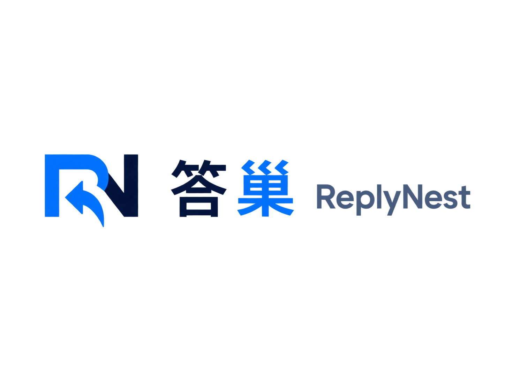

<p align="center"><a href="https://replynest.cn/"></a></p>

# 答巢 ReplyNest

**多渠道 AI 客服、客户洞察与业务自动化平台**

## 🌐 官方网站：[replynest.cn](https://replynest.cn/)

[免注册只读演示](https://console.replynest.cn/demo) · [在线使用文档](https://docs.replynest.cn/) · [自部署指南](docs/DEPLOYMENT.md) · [MIT 许可证](LICENSE)

ReplyNest 将网站聊天、微信公众号、人工坐席、企业知识库、AI 接待和可授权的业务工作流连接到同一个多租户平台。这里发布的是当前开源源码快照，不包含线上账号、客户数据、密钥、内部部署拓扑或旧 Git 历史。

**想直接使用？访问 [https://replynest.cn/](https://replynest.cn/)。想自行部署或二次开发？从下方文档开始。** 开源代码与官方托管服务分别提供；AI 模型、短信、邮件、支付和渠道平台需使用部署者自己的账号及凭据。

## 可以做什么

- **网站客服与微信公众号接待**：Web Chat 接入、共享／独立公众号、商家路由、渠道状态与消息投递诊断。
- **自研客服工作台**：会话分配、状态流转、未读计数、头像昵称、暗色／亮色／跟随系统、客户资料与跨备注搜索。
- **媒体及快捷回复**：公众号图片／视频／语音接收、图片／视频发送、浏览器语音播放、图片及图文组合快捷回复。
- **企业知识库与 RAG**：TXT／Markdown／PDF／DOCX 上传、安全扫描、在线维护、长期／临时文档、有效期、适用范围、版本历史及临期提醒。
- **AI 建议与自动接待**：知识依据、风险校验、人工确认、渠道单独授权、暂停生成与发送限制，不能以模型输出绕过业务权限。
- **AI 客户备注与咨询分析**：事件驱动增量总结、跨会话备注、近期问题与需求／服务偏好图表；默认关闭，须用途授权及每日预算，不覆盖人工备注。
- **AI 定制工坊**：关键词／语义分流、知识读取、外部接口积木、排班预览、授权后的定时转派与消息事件工作流；执行权限独立控制。
- **团队与安全**：角色菜单、跨邮箱域名邀请、多租户边界、隐私申请审核、登录及操作审计。
- **账务与增长**：套餐期限、按生效日的 AI 点数周期、升降级／续费／退款、余额与邀请返佣；需配置自己的支付与运营规则。
- **通知与外部接入**：通知中心、Webhook 签名与有界重试、外部应用 API、状态页和黑盒监控源码。

部分能力依赖特定渠道权限、显式功能开关、用途授权及部署配置。包含 Adapter 不等于已获得对应平台的商用权限；模拟预览不等于授权执行。功能边界见 [当前能力与授权](docs/FEATURES.md)。

## 项目结构

```text
apps/console/                 Next.js 租户控制台、客服工作台、官网和内部管理界面
apps/help-docs/               Docusaurus 中英文当前使用教程
services/channel-integration/ TypeScript 网关、业务 API、渠道与知识工作器
services/blackbox-monitor/    可独立部署的黑盒监控
services/code-runner/         默认隔离的工坊代码运行器
patches/                     Chatwoot CE 的最小集成 Overlay 与迁移
content/template-market/     官方模板定义
packages/design-tokens/      共享视觉变量
docs/                        当前开发、配置、安全与自部署文档
```

## 开始开发

使用 Node.js 24、Python 3、pnpm 11.19.0。需要本地完整服务时还需 Docker Engine／Desktop、Compose，以及 Bash（Windows 可用 WSL2）。

```sh
git clone https://github.com/myj0-0/replynest.git
cd replynest

cd services/channel-integration
npm ci
npm test

cd ../../apps/console
corepack pnpm install --frozen-lockfile
corepack pnpm typecheck
corepack pnpm build

cd ../help-docs
npm ci
npm run build
npm run security:test
npm run security:check
```

完整本地栈、初始账号、渠道配置和外部服务边界见 [自部署指南](docs/DEPLOYMENT.md)。不要把官方生产环境的配置、账号或教程中的示例规则当作你的部署配置。

## 文档与贡献

- [当前文档导航](docs/README.md)
- [架构与安全边界](docs/ARCHITECTURE.md)
- [配置说明](docs/CONFIGURATION.md)
- [开发与测试](docs/DEVELOPMENT.md)
- [安全说明与报告](SECURITY.md)
- [贡献指南](CONTRIBUTING.md)
- [第三方组件及许可](THIRD_PARTY_NOTICES.md)

公开仓库保留源码、可运行测试、迁移和当前教程；不分发历史开发日报、生产验收回执、真实截图、备份或运维登录脚本。默认测试使用合成数据，不需要官方服务的密钥。

## 许可证

ReplyNest 自有代码采用 [MIT](LICENSE)。第三方依赖、容器镜像及 Chatwoot CE 仍受各自许可证约束，不能将整个依赖栈解释为 MIT；详见 [第三方声明](THIRD_PARTY_NOTICES.md)。自部署时请配置自己的运营主体、地址、域名、隐私条款与备案信息，不冒用官方身份。

---

**答巢 ReplyNest · 官方网站：[https://replynest.cn/](https://replynest.cn/)**
